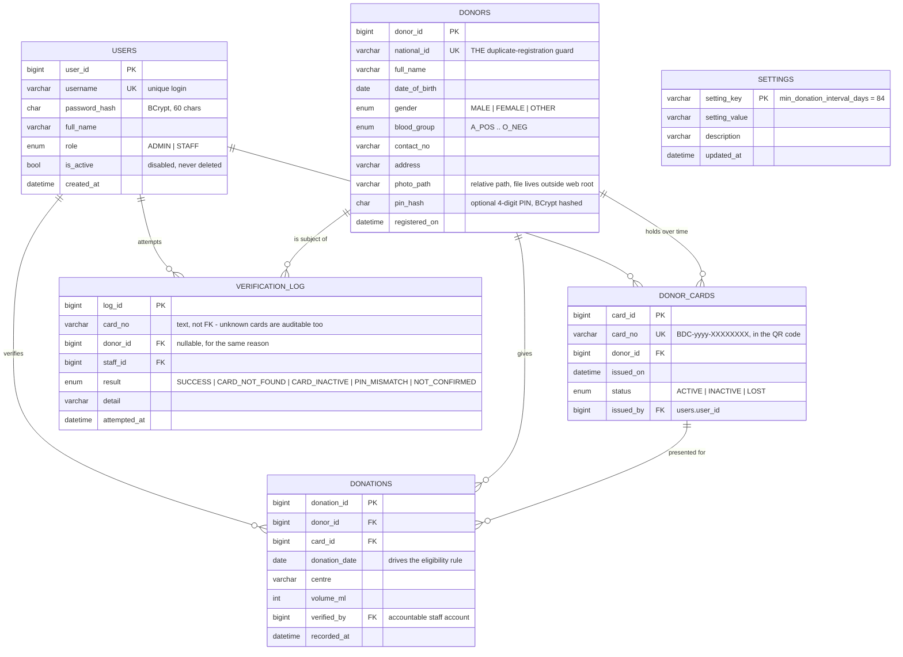

# Entity-relationship diagram

Blood Donation Card Management System · Phase 1 deliverable

`SETTINGS` stands alone by design — it holds the business rules, not data about any entity.

---

## Constraints that do real work

| Constraint | What it prevents |
|---|---|
| `UNIQUE (donors.national_id)` | Duplicate registration — the core problem in Section 2 of the proposal. Enforced by the database, so two centres registering the same person concurrently cannot both succeed |
| `UNIQUE (donor_cards.card_no)` | Two donors sharing a card number. Also the backstop the card generator retries against |
| `FK donations.verified_by → users` | A donation without an accountable staff account |
| `FK verification_log.staff_id → users` | An unattributable audit entry |
| `verification_log.donor_id` **nullable** | Deliberately permits logging an attempt with a card number that matches no donor — otherwise the most suspicious attempts would be the ones that could not be recorded |

## Indexes and why

| Index | Query it serves |
|---|---|
| `uq_donors_national_id` | Duplicate check at registration |
| `uq_cards_card_no` | **Card lookup at the counter** — the 2-second performance requirement |
| `idx_donations_donor_date (donor_id, donation_date DESC)` | "The donor's most recent donation" — a single index seek, the query the entire eligibility rule rests on |
| `idx_cards_donor_status (donor_id, status)` | Finding a donor's one ACTIVE card |
| `idx_vlog_attempted (attempted_at)` | Audit log paging by date |
| `idx_donors_full_name`, `idx_donors_blood_group` | Donor search and the blood-group report |

## Application invariants

Some rules cannot be expressed as constraints and are enforced in code instead:

- **At most one ACTIVE card per donor.** `CardService.issue` deactivates existing cards and inserts the replacement in one transaction, so there is no moment with two or with none. (A partial unique index would express this in PostgreSQL; MySQL has no equivalent.)
- **Donations are append-only.** `DonationDao` has no update or delete method. The history is the evidence the eligibility rule is computed from.
- **History belongs to the donor, not the card.** `donations.donor_id` is what survives a reissue; `card_id` records only which card was presented on the day.
